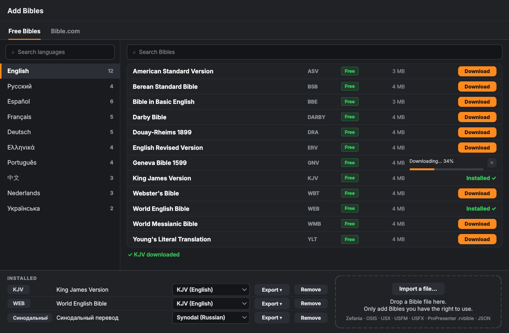

# Custom Bible translations in ProPresenter 7


ProPresenter offers a list of bible translations to use during your services. In Dutch however quite a few translations are missing `NBV21` being one of them. After multiple requests to RenewedVision team to add it, they never did. After inspecting the code and file structure of how ProPresenter stores bibles on the disk I leveraged this to create new translations which can be opened an used.

## Bible Importer app (Mac and Windows)

A window for adding Bibles, built with Python and Qt (PySide6). Its layout follows the Add Bibles window designed for Live Presenter (`specs/add-bibles` in the Live Presenter repository).



**Free Bibles tab.** Pick a language on the left, then **Download** a Bible on the right. The list comes from [getBible](https://getbible.net) and [eBible.org](https://ebible.org) (only Bibles that may be shared). The list is saved for a day, so the window still works without internet (it shows the saved list and says so).

**Bible.com tab.** Licensed Bibles (NBV21, NASB…) from Bible.com, with a warning that your church must have the right to use them. These download chapter by chapter, with a progress bar and **Cancel**. Bible.com changes its pages without notice: if a download fails the window says so plainly and nothing already saved is touched.

**Import a file…** or drop a file on the dashed box. Reads Zefania, OSIS, USX, USFM, USFX, ProPresenter `.rvbible` and JSON files (also a zip of them).

**Installed.** Every downloaded Bible is kept in the app's own folder (Windows: `%APPDATA%\Bible Importer`, Mac: `~/Library/Application Support/Bible Importer`). For each one you can:
- choose its verse numbering (KJV or Synodal), used by the Live Presenter file;
- **Export ▾ › For Live Presenter (.json)…** a file you add in Live Presenter with *Import*;
- **Export ▾ › For ProPresenter (.rvbible)…** a file for ProPresenter;
- **Export ▾ › Install in ProPresenter…** which copies it where ProPresenter looks (on Windows you choose between taking the place of one of ProPresenter's free Bibles, as the command-line tool does, or sideloading);
- **Remove** it.

### Run it
```
pip install -r requirements-gui.txt
python bible_gui.py
```
Ready-made apps: Actions tab › **Build the Bible Importer app** › Run workflow. It runs the tests, builds Windows and Mac apps and keeps them as downloads on the run page. (The Mac app is not signed: right-click › Open the first time.)

### Tests
```
pip install -r requirements-gui.txt pytest
QT_QPA_PLATFORM=offscreen python -m pytest tests
```
`python tools/screenshots.py OUTPUT_FOLDER` saves screenshots with sample data (used to compare the window with the approved renderings).

What the tests cover: the USFM / USX / USFX / OSIS / Zefania readers, the catalogs and their saved lists, the library, both exports (Live Presenter JSON and `.rvbible`, read back again), the ProPresenter install on Mac and Windows folders (with fake folders), the Bible.com reader (with sample pages and a fake server), and the window (download, failure and retry, cancel, import, remove, export, closing during a download).
Not covered: the real Bible.com site (it was not reachable from the build server), and real ProPresenter installs.

The original command-line tool (`bible_import.py`) still works; it now shares its chapter-reading code with the app (`lpbibles/biblecom_html.py`).

## How to automatically

I created a script which automatically downloads a Bible translation from bible.com and converts it to a ProPresenter bible (RVBible format). You can run the script, which will guide you through the steps needed to download and install the bible for ProPresenter.

1. Go to the [releases](https://github.com/martijnlentink/propresenter-custom-bibles/releases) on GitHub
1. Download the attached zip file for your platform from the assets section. There is a Windows and a Mac version.
1. After download, unzip the binary by right clicking to extract
1. Double click to open and run the executable
1. It will guide you through the steps. It will prompt for a [three letter language code](https://en.wikipedia.org/wiki/List_of_ISO_639_language_codes) (eng for English, nld for Dutch, deu for German), will ask for the Bible translation you'd like and will then perform the download operation.

> [!IMPORTANT]
> The script currently only has been tested on Windows, Mac OSX and on numerous translations. If you experience any issues with downloading or after bible installation it not working properly, please create a ticket and I'll be happy to help out.


## Ad hoc scripts

> [!IMPORTANT]
> The manual ad hoc scripts do not work out of the box and contain hard coded values. I would recommend everyone to use the executables or the `bible_import.py` script directly!

### Prerequisites
- Python knowledge
- Knowledge on APIs and HTTP requests
- XML knowledge
- ProPresenter

### Windows

1. Observe that ProPresenter stores the Bibles on the location `%programdata%\RenewedVision\ProPresenter\Bibles`, each bible will be stored in a separate folder with a UUID as name.

2. Run the Python script `retrieve_chapters_nbv21.py`.
<br>This will retrieve NBV21 bible chapter by chapter from the website and stores it in JSON format.
    ```shell
    python retrieve_chapters_nbv21.py
    ```

1. Run the script `json_to_usx.py`
   <br>This will convert the JSON contents to a valid USX book file by merging the different chapter files.
   ```shell
   python json_to_usx.py
   ```

2. Download the `005eb691-c7b9-4f87-84dc-e6afb79e77c5` folder from `/Resources` in this repository and place it in the the bible directory on you disk

3. Place the USX files that were generated in the folder `005eb691-c7b9-4f87-84dc-e6afb79e77c5/USX`

4. Update `BibleData.proPref` file such that it contains an entry for our new translation (By using the translation definition of WARMB).

    <pre>InstalledBiblesNew=["6fb4fb55-78a4-43bc-ac6a-076818c7abfc|BB|BasisBijbel|1",<b>"005eb691-c7b9-4f87-84dc-e6afb79e77c5|WARMB|Nieuwe Bijbelvertaling 2021|1"</b>];</pre>

5. Reopen ProPresenter

### Mac

1. Observe that ProPresenter stores the Bibles on the location `/Library/Application Support/RenewedVision/RVBibles/v2/`, each bible will be stored in a ZIP file with extension `.rvbible`.

2. Run the Python script `retrieve_chapters_nbv21.py`.
<br>This will retrieve NBV21 bible chapter by chapter from the website and stores it in JSON format.
    ```shell
    python retrieve_chapters_nbv21.py
    ```

3. Run the script `json_to_usx.py`
   <br>This will convert the JSON contents to a valid USX book file by merging the different chapter files.
   ```shell
   python json_to_usx.py
   ```

4. Download the `005eb691-c7b9-4f87-84dc-e6afb79e77c5` folder from `/Resources` in this repository and place it in the the bible directory on you disk

5. Place the USX files that were generated in the folder `005eb691-c7b9-4f87-84dc-e6afb79e77c5/USX`

6. Zip the contents of the folder and place it in the directory where the other `.rvbible` files are. Finally rename it such that it has the extension `.rvbible` instead of zip,

7. ProPresenter for Mac should continuously detect new bibles. If this is not the case you can try to restart ProPresenter. Note that incorrect files might cause crashes!

## How does this work
ProPresenter enables you to install bibles through their in application store. This store contains many translations of scriptures in various languages, but since it is a closed store managed completely by RenewedVision only translations they add to their store themselves can be bought, installed and used.

After downloading a bible it is stored on the users machine for easy lookup and (offline) use. Installed bibles on a machine are available for all users and is not bound to a single user profile.
There is a slight difference in how these bibles are stored between Mac OSX systems and Windows.

On Windows these are stored in a Bibles folder, with an index file `BibleData.proRef`. This file holds a list of pipe separated bible installations with UUIDs refering to folder names where the contents of the translations are stored.

On Mac the contents of the bibles, which are the files in the UUID folders, are stored in a ZIP file with `.rvbible` as extension. For Mac there is no index file.

ProPresenter uses bibles stored in the [Unified Scripture XML](https://ubsicap.github.io/usx/) format. This is an open, common format and therefore modifying or extension is possible as there is plenty documentation on this. And with that, it opens up the opportunity for us to sideload different bible translations.

### Notes

- As I did research on how to approach this; to be able to sideload a scripture it is required that the abbreviation is known within ProPresenter. At various points inside the code a translation is identified by its translation, for that reason I am using an abbrevation of a translation and language that I'm not going to be using. In my case this was the `WARMB` translation.
- ProPresenter reads the `rvmetadata.xml` as reference on how to display the bible. That means that the name, abbrevation (through `displayAbbreviation`) can be overwritten. With that the bible translation you load into the system will behave exactly as a normal translation, but under the hood its original abbreviation is used to refer to it.
- On Windows it looks like that, just as the abbreviation, the UUID of a translation also needs to match up with an existing translation.
- On Mac XML comments in the `metadata.xml` will cause exceptions and ProPresenter to crash.
- When the bible translations on Windows are corrupt they will simply not appear in the dropdown. On Mac it will cause crashes.
- As `NBV21` bible is licenced, like most bibles, I am unable to give you its contents.

## Folder structure
ProPresenter stores the Bibles on the Windows location `%programdata%\RenewedVision\ProPresenter\Bibles`, each bible will be stored in a separate folder with a UUID as name. On Mac OSX this is `/Library/Application Support/RenewedVision/RVBibles/v2/`, each bible will be stored in a ZIP file with extension `.rvbible`.

```
│   BibleData.proPref
│
├───818d0d02-fa1e-4038-85f9-bb5fcc65497b | kjv-en.rvbible
│   │   metadata.xml
│   │   rvmetadata.xml
│   │
│   ├───SearchIndex
│   │       segments.gen
│   │       segments_2
│   │       version
│   │       _0.cfs
│   │       _0.cfx
│   │
│   └───USX_1
│           1CH.usx
│           1CO.usx
```
- `BibleData.proPref` - File containing the installed bibles on the machine
  - `{UUID}/metadata.xml` - Holds the [DBL metadata](https://thedigitalbiblelibrary.org/2017/07/07/introducing-dbl-metadata-2-0/) configuration
  - `{UUID}/rvmetadata.xml` - RenewedVision ProPresenter metadata that is used in the Bibles tab
  - `{UUID}/SearchIndex` - Folder containing the [Lucene search index](https://lucene.apache.org/) which is the generated index for the bible
  - `{UUID}/USX` - Folder containing the [USX XML files](https://ubsicap.github.io/usx/) per chapter
