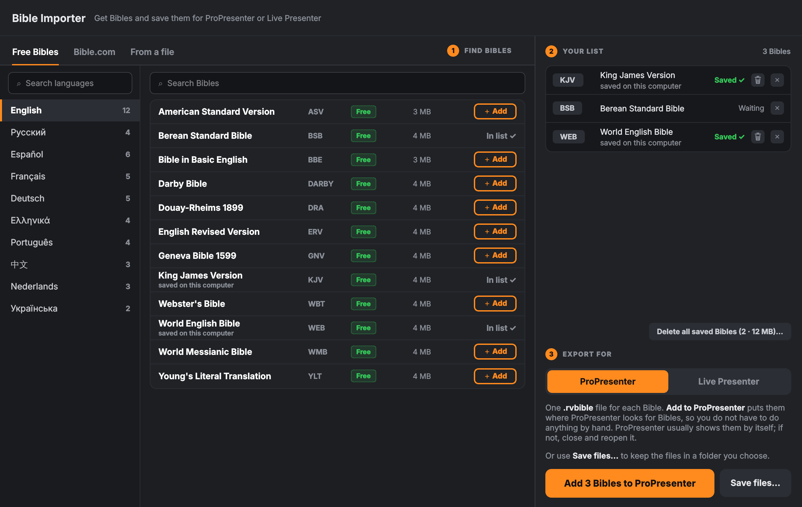

# Bible Importer: custom Bible translations for ProPresenter 7

**Bible Importer** is an app for Mac and Windows that gets Bibles (free ones, licensed ones from Bible.com, or from a file you already have) and builds the Bible files that ProPresenter can use. It is a window built around the original command-line tool by Martijn Lentink, which is still in this repository and described further down.


*Why the original tool was made, in its author's words:* ProPresenter offers a list of bible translations to use during your services. In Dutch however quite a few translations are missing `NBV21` being one of them. After multiple requests to RenewedVision team to add it, they never did. After inspecting the code and file structure of how ProPresenter stores bibles on the disk I leveraged this to create new translations which can be opened an used.

## Please read first: copyright and your responsibility

> [!IMPORTANT]
> **This is a tool for building Bible files for ProPresenter.** It does not contain, sell or hand out any Bible text. Every Bible it builds is made from text that *you* choose to download from a source, or that you supply yourself from your own files. (It can also save the same Bibles in a format for Live Presenter.)

Many Bible translations are protected by copyright, and some of the places the app can download from have their own terms of use. Please only download, convert and use Bibles that you or your church have the right to use, for example public-domain translations, or translations covered by a licence you hold.

By downloading, installing or using this app, you acknowledge and agree that:

- **you alone are responsible** for making sure that your use of any Bible text, and of any website or service the app connects to, is permitted and follows the copyright laws, licences and terms of use that apply to you;
- **neither the author of the original tool (Martijn Lentink), nor the author of this GUI app, nor anyone who contributed to either of them, can be held responsible or liable, in any case or in any capacity,** for improper use of copyrighted material by anyone who uses it.

This project is independent. It is not affiliated with, endorsed by or sponsored by RenewedVision (ProPresenter), Bible.com / YouVersion, getBible, eBible.org, Live Presenter, or any Bible publisher or translation owner. Product and service names belong to their owners.

Thank you for using it with care, and for respecting the work of the translators and publishers who make these Bibles possible.

## Bible Importer app (Mac and Windows)

A window for getting Bibles and turning them into files that ProPresenter or Live Presenter can use. Built with Python and Qt (PySide6).



**1 · Find Bibles.** Three tabs:
- **Free Bibles:** pick a language, click **＋ Add** on the Bibles you want. The list comes from [getBible](https://getbible.net) and [eBible.org](https://ebible.org) (only Bibles that may be shared). The list is saved for a day, so the window still works without internet.
- **Bible.com:** licensed Bibles (NBV21, NASB…), with a warning that your church must have the right to use them. These download chapter by chapter, with progress and Cancel. Bible.com changes its pages without notice: if it fails, the window says so plainly and nothing is damaged.
- **From a file:** drop or choose a Bible you already have (Zefania, OSIS, USX, USFM, USFX, ProPresenter `.rvbible`, Live Presenter / getBible JSON, or a zip of them) to turn it into the other format.

**2 · Your list.** The Bibles you added, each with its state (Waiting, Saved, Downloading, Exported or Added, Failed). Bibles downloaded before are kept on this computer ("saved"), so exporting again is instant.
- The list is **remembered** when you close the app: next time you open it, your Bibles are still there, marked "Saved ✓" or "Waiting".
- The **✕** takes a Bible out of the list; the saved copy stays on this computer. For a Bible that came from a file, the ✕ deletes its saved copy too (after asking), because it can only come back by choosing the file again.
- The **trash can** (only on a Bible that has a saved copy) deletes the copy that Bible Importer keeps on this computer, after asking. Files you saved in a folder, and Bibles already added to ProPresenter, are not touched. A Bible that came from a file leaves the list, because it can only come back by choosing the file again.
- **Delete all saved Bibles (N · size)…**, under the list, is the cleanup: after asking, it deletes every saved copy, also those of Bibles that are no longer in the list. Files you saved in a folder, and Bibles already added to ProPresenter, are not touched.

**3 · Export for** ProPresenter or Live Presenter, then one button:
- **ProPresenter on Mac:** **Add to ProPresenter** puts the Bibles where ProPresenter looks for them. **Save files…** keeps `.rvbible` files in a folder instead.
- **ProPresenter on Windows:** saves `.rvbible` files in a folder. A **?** explains how to add them to ProPresenter by hand, and the quirks of Windows (ProPresenter there only lists Bibles it already knows, so a new Bible has to take the place of one of its free Bibles).
- **Live Presenter:** saves one `.json` file per Bible in a folder. In Live Presenter use *Import a file*. A small picker sets how the Psalms are numbered (KJV or Synodal).

**Nothing is ever overwritten.** If a file with the same name is already there, the new one gets "(2)" in its name, then "(3)" and so on. This is true for files saved in a folder and also for **Add to ProPresenter** on Mac, which puts `<name>.rvbible` in ProPresenter's Bible folder (`~/Library/Application Support/RenewedVision/RVBibles/v2`, or the older `/Library/Application Support/RenewedVision/RVBibles/v2` if that is the one that exists). So adding the same Bible twice leaves two files there, and ProPresenter may list both; the list in the app tells you the name it used ("added to ProPresenter as KJV (2).rvbible"). To get rid of one, delete it in ProPresenter or delete its file from that folder. Saved copies, and the list, live in the app's own folder (Windows: `%APPDATA%\Bible Importer`, Mac: `~/Library/Application Support/Bible Importer`).

### Run it
Needs Python 3.10 or newer (the ready-made apps are built with 3.10).
```
pip install -r requirements-gui.txt
python bible_gui.py
```
Ready-made apps: Actions tab › **Build the Bible Importer app** › Run workflow, then choose **mac** (a `.dmg` disk image), **windows** (a zip) or **all**. It runs the tests first, then builds the app and keeps the result as a download on the run page. It only runs when you press the button (the old build of the command-line tool on every push is gone; it is in the git history). The Mac app runs on Intel and Apple-chip Macs; if that universal build ever fails, the workflow builds an Apple-chip-only app and says so in the run summary.

The Mac app is not signed or notarized by Apple. First launch: open the `.dmg`, drag **Bible Importer** to **Applications**, open it once, then on macOS 15 and later go to System Settings › Privacy & Security › **Open Anyway**; on macOS 13–14 right-click the app › Open.

### Tests, design and icon
```
pip install -r requirements-gui.txt -r requirements.txt pytest
QT_QPA_PLATFORM=offscreen python -m pytest tests
```
The drawings the window was built from are in `design/` (PNG and HTML). `python tools/screenshots.py OUTPUT_FOLDER` saves screenshots of the window with sample data, to compare with them. The app icon (`Resources/icon/`: PNG, Mac `.icns`, Windows `.ico`) is drawn by `python tools/make_icon.py` (needs Pillow).

What the tests cover: the file readers, the catalogs and their saved lists, the library, both exports (read back again), the ProPresenter install on Mac and Windows folders (fake folders), the Bible.com reader (sample pages and a fake server), and the window (adding to the list, exporting for both programs, failure and retry, cancel, import, deleting a saved copy, adding the same Bible twice without replacing a file, the remembered list, the cleanup, closing during an export).
Not covered: the real Bible.com site (it was not reachable from the build server), and real ProPresenter / Live Presenter installs.

**Bible.com Bibles are made exactly as the original tool made them.** The requests use the original's headers (they look like a web browser), and the ProPresenter file has the same USX (section headings, verse ranges like "3-4", and every book Bible.com lists, also those outside the usual 66) and the same `metadata.xml` and `rvmetadata.xml`. `tests/test_original_parity.py` runs the untouched original script (`tests/reference/bible_import_original.py`) and the app on the same chapter pages and checks that every file is identical. Bibles from the free sources and from files are written in the same form, from their verses (so they have no section headings). The Live Presenter `.json` has the 66 usual books, one text per verse.

The original command-line tool (`bible_import.py`) still works; it shares its chapter-reading and file-writing code with the app (`lpbibles/biblecom_html.py`, `lpbibles/biblecom_pp.py`).

> [!NOTE]
> Everything from here on is the original author's notes about the command-line tool (`bible_import.py`) and about how ProPresenter stores Bibles. It still applies to that tool. To run it from the source: `pip install -r requirements.txt`, then `python bible_import.py`. This repository no longer builds its programs on every push; the download link below goes to the original project's releases.

## How to automatically

I created a script which automatically downloads a Bible translation from bible.com and converts it to a ProPresenter bible (RVBible format). You can run the script, which will guide you through the steps needed to download and install the bible for ProPresenter.

1. Go to the [releases](https://github.com/martijnlentink/propresenter-custom-bibles/releases) on GitHub
1. Download the attached zip file for your platform from the assets section. There is a Windows and a Mac version.
1. After download, unzip the binary by right clicking to extract
1. Double click to open and run the executable
1. It will guide you through the steps. It will prompt for a [three letter language code](https://en.wikipedia.org/wiki/List_of_ISO_639_language_codes) (eng for English, nld for Dutch, deu for German), will ask for the Bible translation you'd like and will then perform the download operation.

> [!IMPORTANT]
> The script currently only has been tested on Windows, Mac OSX and on numerous translations. If you experience any issues with downloading or after bible installation it not working properly, please create a ticket and I'll be happy to help out.


## Ad hoc scripts

> [!IMPORTANT]
> The manual ad hoc scripts do not work out of the box and contain hard coded values. I would recommend everyone to use the executables or the `bible_import.py` script directly!

### Prerequisites
- Python knowledge
- Knowledge on APIs and HTTP requests
- XML knowledge
- ProPresenter

### Windows

1. Observe that ProPresenter stores the Bibles on the location `%programdata%\RenewedVision\ProPresenter\Bibles`, each bible will be stored in a separate folder with a UUID as name.

2. Run the Python script `retrieve_chapters_nbv21.py`.
<br>This will retrieve NBV21 bible chapter by chapter from the website and stores it in JSON format.
    ```shell
    python retrieve_chapters_nbv21.py
    ```

1. Run the script `json_to_usx.py`
   <br>This will convert the JSON contents to a valid USX book file by merging the different chapter files.
   ```shell
   python json_to_usx.py
   ```

2. Download the `005eb691-c7b9-4f87-84dc-e6afb79e77c5` folder from `/Resources` in this repository and place it in the the bible directory on you disk

3. Place the USX files that were generated in the folder `005eb691-c7b9-4f87-84dc-e6afb79e77c5/USX`

4. Update `BibleData.proPref` file such that it contains an entry for our new translation (By using the translation definition of WARMB).

    <pre>InstalledBiblesNew=["6fb4fb55-78a4-43bc-ac6a-076818c7abfc|BB|BasisBijbel|1",<b>"005eb691-c7b9-4f87-84dc-e6afb79e77c5|WARMB|Nieuwe Bijbelvertaling 2021|1"</b>];</pre>

5. Reopen ProPresenter

### Mac

1. Observe that ProPresenter stores the Bibles on the location `~/Library/Application Support/RenewedVision/RVBibles/v2/` (older installs: `/Library/Application Support/RenewedVision/RVBibles/v2/`; the tool checks both), each bible will be stored in a ZIP file with extension `.rvbible`.

2. Run the Python script `retrieve_chapters_nbv21.py`.
<br>This will retrieve NBV21 bible chapter by chapter from the website and stores it in JSON format.
    ```shell
    python retrieve_chapters_nbv21.py
    ```

3. Run the script `json_to_usx.py`
   <br>This will convert the JSON contents to a valid USX book file by merging the different chapter files.
   ```shell
   python json_to_usx.py
   ```

4. Download the `005eb691-c7b9-4f87-84dc-e6afb79e77c5` folder from `/Resources` in this repository and place it in the the bible directory on you disk

5. Place the USX files that were generated in the folder `005eb691-c7b9-4f87-84dc-e6afb79e77c5/USX`

6. Zip the contents of the folder and place it in the directory where the other `.rvbible` files are. Finally rename it such that it has the extension `.rvbible` instead of zip,

7. ProPresenter for Mac should continuously detect new bibles. If this is not the case you can try to restart ProPresenter. Note that incorrect files might cause crashes!

## How does this work
ProPresenter enables you to install bibles through their in application store. This store contains many translations of scriptures in various languages, but since it is a closed store managed completely by RenewedVision only translations they add to their store themselves can be bought, installed and used.

After downloading a bible it is stored on the users machine for easy lookup and (offline) use. Installed bibles on a machine are available for all users and is not bound to a single user profile.
There is a slight difference in how these bibles are stored between Mac OSX systems and Windows.

On Windows these are stored in a Bibles folder, with an index file `BibleData.proPref`. This file holds a list of pipe separated bible installations with UUIDs refering to folder names where the contents of the translations are stored.

On Mac the contents of the bibles, which are the files in the UUID folders, are stored in a ZIP file with `.rvbible` as extension. For Mac there is no index file.

ProPresenter uses bibles stored in the [Unified Scripture XML](https://ubsicap.github.io/usx/) format. This is an open, common format and therefore modifying or extension is possible as there is plenty documentation on this. And with that, it opens up the opportunity for us to sideload different bible translations.

### Notes

- As I did research on how to approach this; to be able to sideload a scripture it is required that the abbreviation is known within ProPresenter. At various points inside the code a translation is identified by its translation, for that reason I am using an abbrevation of a translation and language that I'm not going to be using. In my case this was the `WARMB` translation.
- ProPresenter reads the `rvmetadata.xml` as reference on how to display the bible. That means that the name, abbrevation (through `displayAbbreviation`) can be overwritten. With that the bible translation you load into the system will behave exactly as a normal translation, but under the hood its original abbreviation is used to refer to it.
- On Windows it looks like that, just as the abbreviation, the UUID of a translation also needs to match up with an existing translation.
- On Mac XML comments in the `metadata.xml` will cause exceptions and ProPresenter to crash.
- When the bible translations on Windows are corrupt they will simply not appear in the dropdown. On Mac it will cause crashes.
- As `NBV21` bible is licenced, like most bibles, I am unable to give you its contents.

## Folder structure
ProPresenter stores the Bibles on the Windows location `%programdata%\RenewedVision\ProPresenter\Bibles`, each bible will be stored in a separate folder with a UUID as name. On Mac OSX this is `~/Library/Application Support/RenewedVision/RVBibles/v2/` (older installs: `/Library/Application Support/RenewedVision/RVBibles/v2/`), each bible will be stored in a ZIP file with extension `.rvbible`.

```
│   BibleData.proPref
│
├───818d0d02-fa1e-4038-85f9-bb5fcc65497b | kjv-en.rvbible
│   │   metadata.xml
│   │   rvmetadata.xml
│   │
│   ├───SearchIndex
│   │       segments.gen
│   │       segments_2
│   │       version
│   │       _0.cfs
│   │       _0.cfx
│   │
│   └───USX_1
│           1CH.usx
│           1CO.usx
```
- `BibleData.proPref` - File containing the installed bibles on the machine
  - `{UUID}/metadata.xml` - Holds the [DBL metadata](https://thedigitalbiblelibrary.org/2017/07/07/introducing-dbl-metadata-2-0/) configuration
  - `{UUID}/rvmetadata.xml` - RenewedVision ProPresenter metadata that is used in the Bibles tab
  - `{UUID}/SearchIndex` - Folder containing the [Lucene search index](https://lucene.apache.org/) which is the generated index for the bible
  - `{UUID}/USX` - Folder containing the [USX XML files](https://ubsicap.github.io/usx/) per chapter
